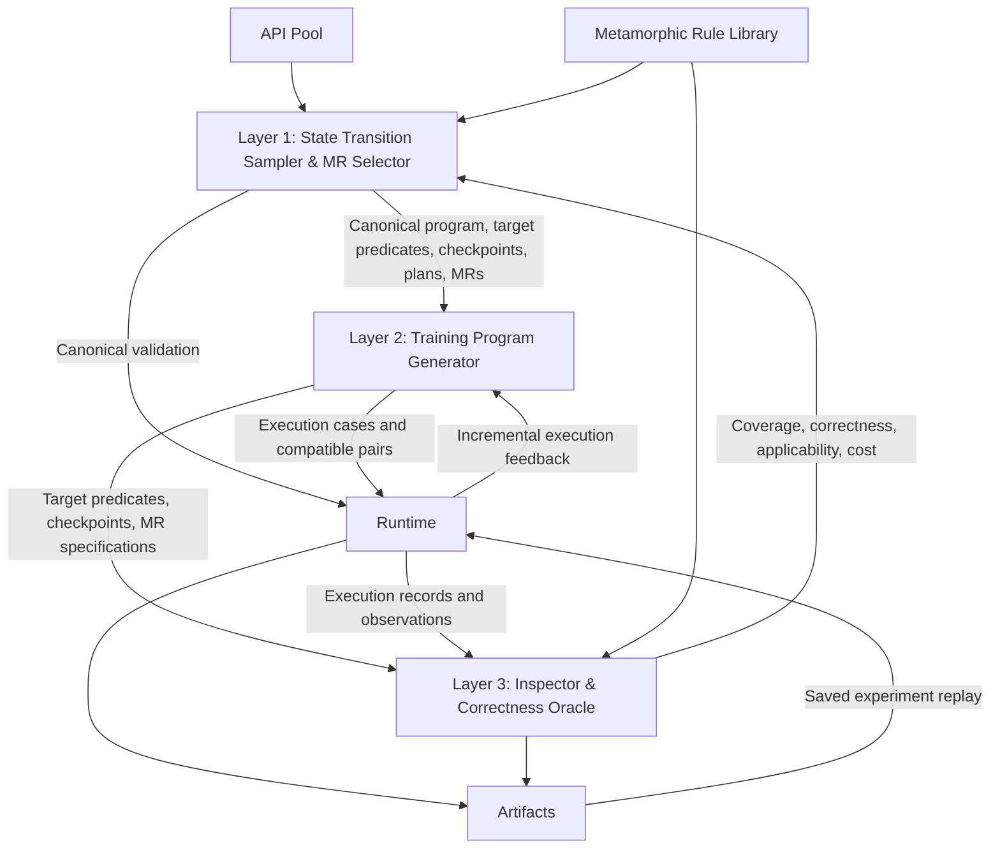

# Mirage Architecture

## Status and Scope

This document describes the agreed architecture for Mirage, a testing framework for deep learning (DL) frameworks. The repository currently contains the package skeleton; the components below describe intended responsibilities, not implemented functionality.

The seven package boundaries are established. Data contracts and execution details are design guidance to refine through approved implementation plans. The target DL framework, sampling algorithms, concrete state abstractions and predicates, coverage units and aggregation policies within the metrics below, and concrete metamorphic rules remain open decisions.

## Motivation and Testing Space

Existing approaches include API/model-input fuzzing, model architecture and API interaction testing, and gradient injection. Mirage explores tensor memory representations and training states, including the paths used to reach those states.

| Dimension | Examples |
| --- | --- |
| Tensor layout | Strides, contiguity, storage offset |
| Storage identity | Cloning, new allocations |
| Storage aliasing | Shared storage, independent storage |
| Device and memory placement | CPU/GPU, pinned/pageable memory |
| Materialization | Direct saving, packing/unpacking, offloading, recomputation |
| Tensor metadata | View/base relationships, version counters, gradient history |
| Training state | Autograd, activation checkpointing, offloading, compilation, graph lifecycle, optimizer, scheduler, AMP, RNG, DataLoader state, distributed state |

Related executions must preserve the initial conditions and semantic inputs required by the selected MR. Keep inputs and initial parameters unchanged whenever the MR requires them; record any permitted differences explicitly. The canonical program is the default source, but some MRs require a different source/follow-up pair.

## Design Principles

- **Separate intent from evidence.** A requested state, generated transition, or configuration flag does not prove that the intended behavior occurred.
- **Use conditional correctness relations.** Validate both the rule's Preconditions and Input Relation, and compare its observables at aligned semantic checkpoints using its Output Relation.
- **Preserve useful coverage.** A state without an applicable metamorphic rule can still contribute verified coverage.
- **Keep generation and judgment separate.** LLMs propose programs and transitions; executable probes and oracle logic establish what happened and whether a relation holds.
- **Make experiments reproducible.** Preserve generated programs, inputs or reconstruction data, execution settings, observations, and results so a saved experiment can be rerun without another LLM call.
- **Start with a focused implementation.** Build one Python package with clear responsibilities. Refine abstractions when concrete use cases require them.

## System Overview

Mirage has three decision-making layers supported by shared contracts, a metamorphic rule library, an execution runtime, and experiment artifacts.



Contracts define the information exchanged between these components. Runtime and artifact services support the layers without making sampling or correctness decisions themselves.

## Package Responsibilities

```text
src/mirage/
├── contracts/       # Data definitions exchanged between components
├── sampler/         # API, state, transition, and MR selection
├── generator/       # Training skeletons and incremental filling
├── inspector/       # State verification and correctness decisions
├── rules/           # MR preconditions, input/output relations, and observables
├── runtime/         # Execution isolation, probes, and observables
└── artifacts/       # Experiment persistence, loading, and replay data
```

| Package | Responsibility | Boundary |
| --- | --- | --- |
| `contracts` | Describe experiment intent, execution evidence, and inspection results | Does not execute programs or select policies |
| `sampler` | Choose what to test and how to reach the target state | Does not manage execution isolation or implement comparators |
| `generator` | Construct canonical-program-derived skeletons, candidate programs, configurations, and MR-compatible pairs | Does not declare correctness from generated source alone |
| `inspector` | Interpret evidence, verify reachability, validate MR applicability and checkpoint alignment, and apply oracles | Does not silently redefine a failed experiment's target |
| `rules` | Supply rule definitions, executable Preconditions and Input Relations, observable extraction requirements, and Output Relations | Does not assume every transformation preserves all outputs |
| `runtime` | Execute programs and collect evidence | Does not select target states or classify arbitrary differences as bugs |
| `artifacts` | Preserve and reload experiment material | Does not regenerate programs during replay |

Keep framework-specific operations localized. Define a broader backend interface when actual framework differences justify it; a multi-framework abstraction is not required for the first milestone.

## Shared Data Contracts

The following are proposed conceptual records. Their exact Python representation and serialization format remain to be decided.

| Contract | Intended contents |
| --- | --- |
| `APIProfile` | Target API identity, input constraints, API properties, available observables |
| `CanonicalProgram` | Source `P_0`, legal default configuration, initial concrete state reconstruction, inputs, API/backward execution validation evidence |
| `TrainingStateSpec` | State abstraction `alpha`, target predicate `phi_i`, required execution checkpoint, and necessary state probes |
| `TransitionPlan` | Ordered actions `tau_i`, initial state reconstruction, injection points, action preconditions, expected effects, verification probes, unresolved planning status |
| `MRSpec` | Rule identity, Preconditions, Input Relation, initial condition constraints, observables, semantic checkpoint alignment, Output Relation, numerical tolerance and nondeterminism policies |
| `ExecutionCase` | Program `P` and configuration `c`: initial parameters, inputs, RNG settings, environment, and other required execution settings |
| `ExperimentSpec` | API, canonical program, target predicates/checkpoints, transition plans, execution cases and pair roles, selected rules or fallback mode, execution limits |
| `ExecutionRecord` | Executed case reference, environment, API/backward evidence, action traces, concrete/abstract state observations and checkpoints, observables, errors, resource and generation cost references |
| `InspectionResult` | Execution assessment, API/state/transition verification, dynamic Preconditions and Input Relation results, checkpoint alignment, oracle verdicts, failure validation evidence, coverage and cost feedback |

Experiment intent must remain separate from execution observations. Tensor storage identity and aliasing should be checked through relationships within the relevant execution; raw addresses from separate processes are not meaningful equality targets.

## State and Execution Model

Concrete training state `sigma` includes model parameters, gradients, optimizer state, scheduler state, AMP state, RNG state, DataLoader state, and the tensor metadata and execution context needed by the experiment. The abstraction function `alpha` maps that state to an abstract state used for testing and coverage tracking. The concrete representation of each component remains framework-dependent.

| Symbol | Meaning |
| --- | --- |
| `U`, `u` | API pool and selected target API `u ∈ U` |
| `P_0`, `sigma_0` | Canonical training program and its initial concrete training state |
| `m`, `i` | Number of target predicates sampled this round and target index `1 ≤ i ≤ m` |
| `phi_i` | Target predicate over abstract states at a specified execution checkpoint |
| `k_i`, `t` | Number of actions in sequence `i` and transition index `1 ≤ t ≤ k_i` |
| `a_t^(i)`, `tau_i` | A legal transition action and ordered sequence `(a_1^(i), ..., a_k_i^(i))` |
| `sigma_t^(i)` | Concrete state after the first `t` actions, starting from `sigma_0^(i) = sigma_0` |
| `P_i` | Training program generated for target predicate `phi_i` |
| `e = (P, c)` | Execution case: a training program and its execution configuration |
| `e_a`, `e_b` | Source and follow-up execution cases used by an MR |
| `M ∈ M_library` | Selected metamorphic rule from the predefined library |
| `Pre_M`, `In_M` | MR Preconditions and Input Relation over the execution pair |
| `Obs_M`, `Out_M` | Observable extraction at the MR's semantic checkpoints and the Output Relation |

A predicate describes a condition such as a tensor representation or training context, rather than requiring a tensor or optimizer state to equal an exact sampled numerical value. Each target includes an execution checkpoint, such as immediately before the target API, before backward, or after an optimizer step. A matching state observed at a different point does not establish that target's reachability.

## Layer 1: State Transition Sampler & MR Selector

Layer 1 owns test selection and uses feedback to determine subsequent experiments.

### Canonical Program Generation

Select `u` from `U` and use an LLM to generate `P_0` with a legal default training configuration. Execute it to verify that it runs and calls the target API. For backward correctness testing, also verify the relevant backward path. Runtime provides this execution evidence; Layer 1 uses it to establish a valid exploration starting point.

`P_0` is the default source program. It need not be the comparison baseline for every MR, and its observables may be used only where the MR's pair constraints hold.

### Target Training State Sampling

Sample `m` predicates `phi_1, ..., phi_m` using the target API, coverage feedback, and expected testing value. Consider legal training contexts, dependencies and restrictions among state dimensions, unexplored API × State combinations, expected coverage gain, and generation cost.

Preserve the initial conditions and semantic inputs needed for cross-program MRs. Permitted differences are defined by the MR. State sampling selects conditions over `alpha(sigma)`, not precise numerical target states.

### Valid State Transition Planning

For each predicate, plan actions such as `backward()`, `optimizer.step()`, `zero_grad()`, or checkpoint restore:

$$
\sigma_0
\xrightarrow{a_1^{(i)}} \sigma_1^{(i)}
\xrightarrow{a_2^{(i)}} \cdots
\xrightarrow{a_{k_i}^{(i)}} \sigma_{k_i}^{(i)}.
$$

Actions must satisfy the framework's legal operation constraints and ordering. The plan aims to establish the target condition at its specified execution checkpoint:

$$
\phi_i\left(\alpha\left(\sigma_{k_i}^{(i)}\right)\right)
= \mathrm{True}.
$$

If a legal path cannot be found, resample, adjust the target predicate, or mark the plan unresolved. Layer 1 proposes candidate sequences; actual reachability is verified by Layer 3. Final state conditions and transition paths are distinct exploration targets: different paths can reach similar representations while exercising different lifecycle behavior.

### Metamorphic Relation Selection

Statically filter the predefined MR library using the target API, canonical program, transition sequence, Preconditions, Input Relation, and required observables. Rank candidates by expected coverage gain, unexplored API × MR combinations, predicted applicability, and generation/execution cost. Static applicability is provisional until Layer 3 validates it dynamically.

If no MR applies, retain the legal transition plan for another explicitly defined correctness oracle or coverage-only execution. Do not sacrifice API coverage because no MR applies. Start with a simple, reproducible sampling policy before introducing adaptive optimization.

## Layer 2: Training Program Generator

Layer 2 receives the target API, canonical program, target state predicates and execution checkpoints, transition plans, and selected MRs.

### Training Loop Skeleton Construction

Use an LLM to derive a reusable skeleton from `P_0`, preserving basic training semantics and marking injection regions. Include forward/loss computation, backward/gradient accumulation, optimizer/scheduler updates, AMP/gradient scaling, checkpoint/restore, and distributed training operations where relevant.

The skeleton should expose meaningful lifecycle locations:

```text
setup
  -> model and optimizer initialization
  -> input preparation
  -> forward
  -> loss
  -> backward and gradient accumulation
  -> optimizer and scheduler updates
  -> next iteration or cleanup
```

AMP, checkpoint/restore, and distributed actions have injection points appropriate to their legal lifecycle requirements. Transitions specify where they can execute, their preconditions, expected effects, verification probes, and known incompatibilities. An input-layout transformation and saved-tensor materialization need different injection points and cannot be represented adequately by one global flag.

### Incremental State Transition Injection

Use an LLM, potentially a smaller language model, to inject actions from `tau_i` incrementally and produce `P_i`. After each partial injection, check syntax and runtime legality, use execution feedback for repair, and preserve the target API's relevant execution paths.

Generation must obey the selected MR's Preconditions, Input Relation, initial condition constraints, and semantic checkpoint requirements. Successful transitions do not establish MR applicability; do not introduce changes to training semantics beyond those permitted by the MR.

### MR-Compatible Program Pair Construction

Use `(P_0, P_i)` as the source/follow-up program pair when appropriate. Otherwise construct another legal pair compatible with the MR. Assign each program an execution configuration `c`, including initial parameters, inputs, RNG settings, and the required execution environment, to form `(e_a, e_b)`.

The intended Input Relation must hold, and both executions must expose comparable semantic checkpoints. Equal program lengths or operation counts are not required.

### Generated Program Validation

Check syntax, runtime legality, actual target API execution, legal transition ordering, necessary conditions for the target state, and preservation of static MR constraints. Repair generation failures incrementally. If a legal program no longer supports its selected MR, reselect the MR or retain it as a coverage-only test.

Forward generated programs, execution configurations, target predicates/checkpoints, and MR specifications to Layer 3. Preliminary checks and generated code alone do not prove state attainment. Layer 2 uses runtime and inspection feedback to reject or revise candidates; Layer 3 owns the final evidence-based assessment. Record failed generation attempts and retries as costs.

## Layer 3: Inspector & Correctness Oracle

### Runtime State & API Execution Validation

Execute the generated programs through the runtime, collecting traces and necessary training states. Check execution validity and the availability of required observations. Verify actual target API execution, the relevant backward path when required, legal completion of transition actions, and the target predicate at the specified execution checkpoint.

For the concrete state `sigma` observed at that checkpoint, require:

$$
\phi_i(\alpha(\sigma)) = \mathrm{True}.
$$

Generated code, requested actions, and configuration flags are not reachability evidence. Failure to execute the required API path or reach the target makes the case invalid, rather than a correctness violation.

### Metamorphic Correctness Testing

For an MR `M` and legal execution pair `(e_a, e_b)`, a sound relation requires the following property in a correct framework implementation:

$$
\begin{aligned}
&\operatorname{Pre}_M(e_a,e_b)
\land \operatorname{In}_M(e_a,e_b) \\
&\quad\Rightarrow
\operatorname{Out}_M\left(
\operatorname{Obs}_M(e_a),
\operatorname{Obs}_M(e_b)
\right).
\end{aligned}
$$

The inspector must dynamically validate both Preconditions and Input Relation. Only when both hold, the executions are valid, and the required semantic checkpoints align, evaluate the Output Relation. Record the pair, configurations, and comparison settings explicitly.

Extract only the observables required by the MR: for example, loss, gradients, model parameters, optimizer internal state, scheduler/AMP state, or checkpoint-restored state. Align semantic checkpoints rather than requiring equal operation counts.

For numerical equivalence MRs, set tolerances according to dtype, operation, and expected numerical error. Other MRs use their specified Output Relations. Nondeterminism handling also depends on the API, transformation, and execution environment. Equality of every observable is not a default requirement.

### Correctness Verdict & Failure Validation

Apply the following verdicts after runtime validation and MR testing:

| Verdict | Condition |
| --- | --- |
| Invalid | Program is invalid, the target API or required backward path did not execute, or the required target state was not reached |
| Inapplicable | MR Preconditions or Input Relation do not hold, or required semantic checkpoints cannot align |
| Pass | The MR applies and its Output Relation holds |
| Suspected Failure | The MR applies but its Output Relation does not hold |

Do not compress the experiment into one pass/fail value. Retain separate execution status, API evidence, state/transition verification, MR applicability, and oracle verdicts. Missing evidence must not count as successful verification.

For a Suspected Failure:

1. **Reproduce:** Check whether the failure is reproducible.
2. **Minimize:** Reduce the program, input, and transition sequence while retaining the failure and applicable MR conditions.
3. **Validate:** Recheck Preconditions, Input Relation, checkpoint alignment, and numerical comparison conditions.
4. **Confirm:** Use another correctness oracle or independent evidence to determine whether the result is a framework defect.

An oracle violation is a potential bug until supported by this validation. Keep generation failures, unresolved transition plans, state-attainment failures, and inapplicable MRs distinct. Without an MR, use another explicitly defined oracle or retain verified coverage with correctness unassessed; coverage-only cases receive no correctness pass. Absence of MR violations does not prove framework correctness.

## Metamorphic Rule Library

Each rule should provide an identity, documented assumptions, executable Preconditions and Input Relation, initial condition constraints, required observables and their semantic checkpoints, checkpoint alignment requirements, and an executable Output Relation. Specify numerical tolerance and nondeterminism policies where needed. Rules may relate observables without requiring exact equality.

The initial library should contain explicitly reviewed rules. LLM-based selection references established rule identities; newly generated correctness assumptions must not automatically become accepted oracles.

The sampler uses rule metadata for static selection and ranking. The generator constructs compatible execution pairs under the same specification. The inspector dynamically validates Preconditions and Input Relation, aligns checkpoints, and evaluates the Output Relation from that rule definition.

## Runtime and Artifacts

The runtime runs execution cases in independent processes with execution limits, reconstructs the required initial state and inputs, and collects API/backward traces, action traces, state probes, checkpoint observations, observables, and errors. It supports execution during canonical validation, incremental generation, final inspection, and replay.

Related executions need an initialization protocol that satisfies the MR's Input Relation and initial condition constraints. Record seeds, initial parameters, inputs or reconstruction data, optimizer/scheduler/AMP/RNG/DataLoader state where required, device settings, and relevant environment information. A shared seed alone does not establish comparable initial conditions. Record MR-permitted differences between case configurations.

Artifacts should preserve enough material to inspect and rerun an experiment:

- Experiment specification, canonical source, generated sources, execution configurations, and source/follow-up pair roles.
- State abstraction definitions or version references, target predicates, execution checkpoints, and transition plans.
- Selected MR identities with definitions or version references, including Preconditions, Input Relation, Output Relation, and semantic checkpoint requirements.
- Initial state and input reconstruction material and execution settings.
- Relevant framework, device, and environment information.
- API/backward evidence, action traces, state observations at identified checkpoints, and captured observables.
- Standard output/error, failures, inspection results, reproduction/minimization/validation evidence, and costs.

Replay uses the saved programs and configuration without calling the LLM again. Environment-dependent limitations should be reported explicitly. Storage format and retention policy remain open decisions.

## Feedback and Coverage

Layer 3 returns the following feedback to Layer 1:

| Metric | Definition |
| --- | --- |
| API Coverage | Target APIs actually executed / API Pool |
| State Coverage | Covered target state predicates / sampled target state predicates |
| Transition Coverage | Covered legal abstract state transitions / known legal candidate transitions |
| API × MR Coverage | API × MR combinations with completed valid MR testing / known feasible combinations |
| MR Applicability | Proportions of applicable and inapplicable MR tests |
| Correctness Feedback | Suspected Failures and Confirmed Defects, retaining supporting evidence and validation status |
| Generation Cost | Time and resource costs of program generation and execution, including failed attempts and repairs |

Denominators based on known feasible candidates do not represent all theoretically possible combinations. Predicate identity, concrete abstraction definitions, candidate-set construction, aggregation rules, and applicability accounting remain to be specified through approved implementation plans. Preserve the relevant candidate sets and observations so reported metrics have an interpretable scope.

Credit coverage only when supported by relevant evidence. A failed experiment may still contain valid partial observations, but it must not be counted as reaching its full target. A run without an applicable MR can contribute verified coverage without receiving a correctness pass.

Use feedback to update state sampling and MR ranking. Prioritize unexplored API × State × MR combinations, training contexts with higher expected coverage gain, transitions more likely to expose correctness bugs, and reasonable generation/execution cost. Repeat the three layers as a feedback-guided testing loop.

The cost model and adaptive sampling policy remain to be defined. Preserve the underlying records so later policy changes do not depend solely on previously aggregated scores.

## Implementation Sequence

1. **Define contracts and transition verification.** Agree on the minimum experiment records, concrete/abstract state model, target predicates and checkpoints, initialization protocol, execution pair constraints, and evidence needed for the first transitions.
2. **Complete one reproducible workflow.** Select one DL framework, a small API pool, a few tensor-representation transitions, and reviewed MRs. Connect canonical generation, incremental generation, compatible execution pair construction, execution, inspection, persistence, and replay.
3. **Add feedback-driven exploration.** Introduce coverage-guided sampling and MR ranking after the feedback is reliable.
4. **Expand state complexity.** Extend into autograd and graph lifecycle, checkpointing and offloading, compilation, optimizer state, and distributed state as approved.

The first milestone should demonstrate valid MR testing, inapplicability caused by an unmet Precondition or Input Relation, checkpoint alignment checks, a state-attainment failure, and a coverage-only result. These establish that the framework distinguishes its own generation and validation outcomes from potential DL framework defects.

Implement each step through the file-scoped planning and approval workflow in `AGENTS.md`. This document does not authorize unrequested implementation, dependencies, or refactoring.
