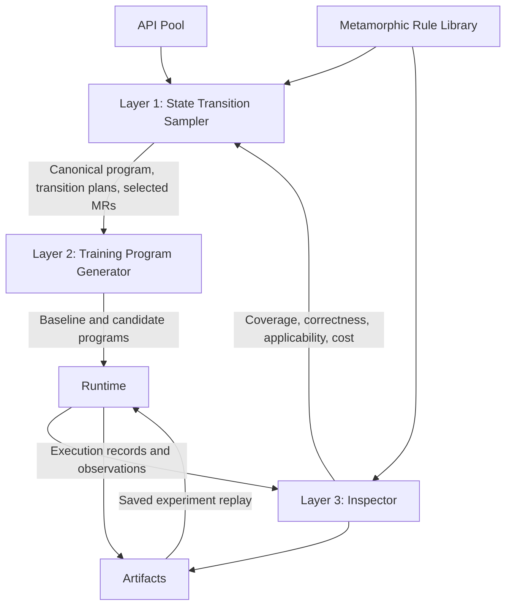

# Mirage Architecture

## Status and Scope

This document describes the agreed architecture for Mirage, a testing framework for deep learning (DL) frameworks. The repository currently contains the package skeleton; the components below describe intended responsibilities, not implemented functionality.

The seven package boundaries are established. Data contracts and execution details are design guidance to refine through approved implementation plans. The target DL framework, sampling algorithms, coverage definitions, and concrete metamorphic rules remain open decisions.

## Motivation and Testing Space

Existing approaches include API/model-input fuzzing, model architecture and API interaction testing, and gradient injection. Mirage explores tensor memory representations and training states, including the paths used to reach those states.

| Dimension | Examples |
| --- | --- |
| Tensor layout | Strides, contiguity, storage offset |
| Storage identity | Cloning, new allocations |
| Storage aliasing | Shared storage, independent storage |
| Device and memory placement | CPU/GPU, pinned/pageable memory |
| Materialization | Direct saving, packing/unpacking, offloading, recomputation |
| Tensor metadata | View/base relationships, version counters, gradient history |
| Training state | Autograd, activation checkpointing, offloading, compilation, graph lifecycle, optimizer state, distributed state |

Inputs and initial parameters should remain unchanged across related programs whenever possible. Any necessary differences must be recorded and considered by the selected correctness oracle.

## Design Principles

- **Separate intent from evidence.** A requested state, generated transition, or configuration flag does not prove that the intended behavior occurred.
- **Use conditional correctness relations.** A transformation is comparable only under the applicable rule's preconditions and observable definitions.
- **Preserve useful coverage.** A state without an applicable metamorphic rule can still contribute verified coverage.
- **Keep generation and judgment separate.** LLMs propose programs and transitions; executable probes and oracle logic establish what happened and whether a relation holds.
- **Make experiments reproducible.** Preserve generated programs, inputs or reconstruction data, execution settings, observations, and results so a saved experiment can be rerun without another LLM call.
- **Start with a focused implementation.** Build one Python package with clear responsibilities. Refine abstractions when concrete use cases require them.

## System Overview

Mirage has three decision-making layers supported by shared contracts, a metamorphic rule library, an execution runtime, and experiment artifacts.



Contracts define the information exchanged between these components. Runtime and artifact services support the layers without making sampling or correctness decisions themselves.

## Package Responsibilities

```text
src/mirage/
├── contracts/       # Data definitions exchanged between components
├── sampler/         # API, state, transition, and MR selection
├── generator/       # Training skeletons and incremental filling
├── inspector/       # State verification and correctness decisions
├── rules/           # MR definitions, preconditions, and comparators
├── runtime/         # Execution isolation, probes, and observables
└── artifacts/       # Experiment persistence, loading, and replay data
```

| Package | Responsibility | Boundary |
| --- | --- | --- |
| `contracts` | Describe experiment intent, execution evidence, and inspection results | Does not execute programs or select policies |
| `sampler` | Choose what to test and how to reach the target state | Does not manage execution isolation or implement comparators |
| `generator` | Construct canonical-program-derived skeletons and candidate programs | Does not declare correctness from generated source alone |
| `inspector` | Interpret evidence, validate preconditions, and apply oracles | Does not silently redefine a failed experiment's target |
| `rules` | Supply rule definitions, executable preconditions, and comparison logic | Does not assume every transformation preserves all outputs |
| `runtime` | Execute programs and collect evidence | Does not select target states or classify arbitrary differences as bugs |
| `artifacts` | Preserve and reload experiment material | Does not regenerate programs during replay |

Keep framework-specific operations localized. Define a broader backend interface when actual framework differences justify it; a multi-framework abstraction is not required for the first milestone.

## Shared Data Contracts

The following are proposed conceptual records. Their exact Python representation and serialization format remain to be decided.

| Contract | Intended contents |
| --- | --- |
| `APIProfile` | Target API identity, input constraints, API properties, available observables |
| `CanonicalProgram` | Baseline source, default state, input and parameter reconstruction, execution settings |
| `TrainingStateSpec` | Required training-state and tensor-representation conditions at specified observation points |
| `TransitionPlan` | Ordered transitions, injection points, preconditions, expected effects, verification probes |
| `MRSpec` | Rule identity, applicability conditions, program-pair requirements, observables, comparator, numerical tolerance policy |
| `ExperimentSpec` | API, canonical program, target state, transition plan, selected rules or fallback mode, seed, device, execution limits |
| `ExecutionRecord` | Executed program reference, environment, API evidence, state observations, observables, errors, resource and generation cost references |
| `InspectionResult` | Execution assessment, API/state/transition verification, MR applicability, oracle verdicts, coverage feedback, diagnostic evidence |

Experiment intent must remain separate from execution observations. Tensor storage identity and aliasing should be checked through relationships within the relevant execution; raw addresses from separate processes are not meaningful equality targets.

## Layer 1: State Transition Sampler

Layer 1 owns test selection and uses feedback to determine subsequent experiments.

1. **Select an API.** Choose a target from the API pool.
2. **Establish the baseline.** Request LLM generation of a canonical program `P_0` in the default training state `s_0`. Validate its execution before using its observables as a baseline.
3. **Sample target states.** Use algorithm `A_1` and coverage criterion `C_1` to select `m` target final training states.
4. **Plan transitions.** Construct an ordered path for each target:

   ```text
   s_0 -> s_1^(i) -> ... -> s_k_i^(i) = s_target^(i)
   ```

5. **Select metamorphic rules.** Filter and rank rules using the target API, canonical program, transitions, preconditions, and available observables.
6. **Consume feedback.** Update future sampling and MR selection using verified coverage, applicability, correctness results, and generation/execution costs.

The internal responsibilities are API selection, state sampling, transition planning, and MR selection. Final states and transition paths are distinct exploration targets: different paths can reach similar final representations while exercising different lifecycle behavior.

MR ranking should consider expected coverage gain, unexplored API/MR combinations, applicability, and execution cost. Applicability inferred during planning is provisional until checked against execution evidence.

If no MR applies, retain the target state and use another explicitly defined correctness oracle or coverage-only execution. Start with a simple, reproducible sampling policy before introducing adaptive optimization.

## Layer 2: Training Program Generator

Layer 2 receives the target API, canonical program, transition plans, and selected MRs. It derives a reusable training loop skeleton and incrementally fills transition regions to produce `P_1, ..., P_m`.

The skeleton should expose meaningful lifecycle locations:

```text
setup
  -> model and optimizer initialization
  -> input preparation
  -> forward
  -> loss
  -> backward
  -> optimizer step
  -> next iteration or cleanup
```

Transitions specify where they can execute, their preconditions, expected effects, verification probes, and known incompatibilities. An input-layout transformation and saved-tensor materialization need different injection points and cannot be represented adequately by one global flag.

Incremental filling may use a smaller language model. Each generated candidate must be checked through the runtime and inspector before its target state is accepted as reached. Layer 2 uses that feedback to reject or revise candidates; Layer 3 owns the final evidence-based assessment. Record failed generation attempts and retries as costs.

## Layer 3: Inspector

The inspector evaluates execution evidence in the following order:

1. Determine whether execution completed and whether required observations are available.
2. Verify that the target API actually executed at the relevant point.
3. Verify the target state and planned transition path where supported by probes.
4. Evaluate the selected MR's preconditions against the actual program pair and observations.
5. Compare the observables specified by the applicable oracle.
6. Produce separate coverage, applicability, correctness, and diagnostic results.

For transformation-based metamorphic testing, prefer the canonical pair:

```text
R_j(O(P_0), O(P_i)) = True
```

Here, `O` extracts the rule's specified observables, such as loss, gradients, parameters, or optimizer state. If direct comparison with the baseline is unsuitable, use another program pair with a valid MR. Record the pair and comparison settings explicitly.

Numerical tolerances and nondeterminism handling depend on the API, transformation, dtype, and execution environment. Equality of every observable is not a default requirement.

Do not compress the experiment into one pass/fail value. Retain separate execution status, API evidence, state/transition verification, MR applicability, and oracle verdicts. Missing evidence must not count as successful verification.

An oracle violation is a potential bug requiring supporting evidence and further validation. Generation failure, an unmet precondition, or failure to reach a state is a different outcome. Without a suitable oracle, retain verified coverage and leave correctness unassessed.

## Metamorphic Rule Library

Each rule should provide an identity, documented assumptions, executable preconditions, required observables, and executable comparison logic. Rules may relate observables without requiring exact equality.

The initial library should contain explicitly reviewed rules. LLM-based selection references established rule identities; newly generated correctness assumptions must not automatically become accepted oracles.

The sampler uses rule metadata for candidate selection and ranking. The inspector evaluates runtime preconditions and invokes the comparator from the same rule definition.

## Runtime and Artifacts

The runtime runs experiments in independent processes with execution limits, reconstructs inputs and initial parameters, and collects API traces, state probes, observables, and errors. It supports execution during baseline validation, incremental generation, final inspection, and replay.

Related programs need a consistent initialization protocol. Record seeds, initial parameters, inputs or reconstruction data, device settings, and relevant environment information. A shared seed alone does not establish comparable initial conditions.

Artifacts should preserve enough material to inspect and rerun an experiment:

- Experiment specification, canonical source, and generated sources.
- Transition plans and selected MR identities with the definitions or version references used.
- Input and parameter reconstruction material and execution settings.
- Relevant framework, device, and environment information.
- API evidence, state observations, and captured observables.
- Standard output/error, failures, inspection results, and costs.

Replay uses the saved programs and configuration without calling the LLM again. Environment-dependent limitations should be reported explicitly. Storage format and retention policy remain open decisions.

## Feedback and Coverage

Layer 3 returns API coverage, state transition coverage, MR applicability, correctness feedback, and generation cost to Layer 1. Execution cost can inform ranking as well.

Credit coverage only when supported by relevant evidence. A failed experiment may still contain valid partial observations, but it must not be counted as reaching its full target. A run without an applicable MR can contribute verified coverage without receiving a correctness pass.

The precise coverage units, aggregation rules, cost model, and adaptive sampling policy remain to be defined. Preserve the underlying records so later policy changes do not depend solely on previously aggregated scores.

## Implementation Sequence

1. **Define contracts and transition verification.** Agree on the minimum experiment records, initialization protocol, observation points, and evidence needed for the first transitions.
2. **Complete one reproducible workflow.** Select one DL framework, a small API pool, a few tensor-representation transitions, and reviewed MRs. Connect baseline generation, variant generation, execution, inspection, persistence, and replay.
3. **Add feedback-driven exploration.** Introduce coverage-guided sampling and MR ranking after the feedback is reliable.
4. **Expand state complexity.** Extend into autograd and graph lifecycle, checkpointing and offloading, compilation, optimizer state, and distributed state as approved.

The first milestone should demonstrate a valid comparison, an unmet precondition, a state-attainment failure, and a coverage-only result. These establish that the framework distinguishes its own generation and validation outcomes from potential DL framework defects.

Implement each step through the file-scoped planning and approval workflow in `AGENTS.md`. This document does not authorize unrequested implementation, dependencies, or refactoring.
