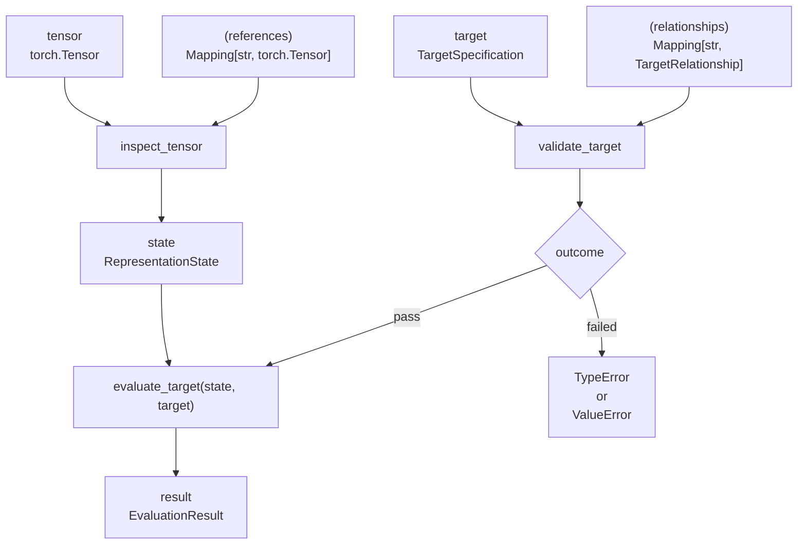

# Design

## Summary

Send the tensor we want to check into the function `inspect_tensor` , and the components will create a `RepresentationState` called s.

Create a `TargetSpecification` called t, which contains any condition we want. Use the function `validate_target` to make sure t is a valid target.

Then call the function `evaluate` to determine whether s meets the requirements of t. If not, report which column is mismatched.

## Architecture Overview



## End-to-End Example

```python
state = inspect_tensor(t, refs)
target = TargetSpecification{...}
if (validate_target(target))
	outcome = evaluate(state, target)
```

## Implementation

### **D1 — inspect_tensor**

**Related Requirements:** FR-1

#### **Data Structures and Algorithms (Optional)**

Please let me know if anything else need to be added.

```python
from typing import Literal

Undetermined = Literal["undetermined"]

class TensorRelationship:
    same_object: bool
    shares_storage: bool | Undetermined
    overlaps_memory: bool | Undetermined

class RepresentationState:
	# Basic metadate
	shape: tuple[int, ...]
	dtype: torch.dtype
	device: torch.device
	layout: torch.layout
	
	# Memory arrangement
	stride: tuple[int, ...]
	storage_offset: int
	storage_nbytes: int
	data_ptr_alignment: int | Undetermined # the largest number of alignment bytes
	is_contiguous: bool
	is_channels_last_contiguous: bool
	is_channels_last_3d_contiguous: bool
	is_pinned: bool
	
	# View and overlap
	is_view: bool
	has_internal_overlap: bool | Undetermined
	is_non_overlapping_and_dense: bool
	
	# Lazy value transformations
	is_conj: bool
  is_neg: bool
	
	# Relationships
	relationships: Mapping[str, TensorRelationship] = field(
        default_factory=dict
    )
```

#### **Execution Flow**

Call `inspect_tensor(t, refs)` to get `t`'s representation state `state` :

The function will check each field, fill the result in `state` , and finally return it. The Inspect methods are as follows.

(Let `r`  be one of the references.)

| **Field** | **Inspect Method** | **Others** |
| --- | --- | --- |
| `shape` | `tuple(t.shape)` | turn `t.shape` into `tuple` and save |
| `dtype`  | `t.dtype` | save the return value directly |
| `device` | `t.device` | save the return value directly |
| `layout` | `t.layout` | save the return value directly |
| `stride` | `tuple(t.stride())` | save the return value directly |
| `storage_offset` | `t.storage_offset()` | save the return value directly |
| `storage_nbytes` | `t.untyped_storage().nbytes()` | save the return value directly |
| `data_ptr_alignment` | `address & -address`  | mark as undetermined if address is 0; otherwise, save the value directly |
| `is_contiguous` | `t.is_contiguous(memory_format=torch.contiguous_format)` | save the return value directly |
| `is_channels_last_contiguous` | `t.is_contiguous(memory_format=torch.channels_last)` | if ( t.ndim ≠ 4 ) save `False` 
else save the return value |
| `is_channels_last_3d_contiguous` | `t.is_contiguous(memory_format=torch.channels_last_3d)` | if ( t.ndim ≠ 5 ) save `False` 
else save the return value |
| `is_pinned` | `t.is_pinned` | save the return value directly |
| `is_view` | `t._is_view()` | save the return value directly |
| `has_internal_overlap` | `_inspect_internal_overlap(t)` | calculate the storage spaces of `t` by its `shape`, `stride`,  `storage_offset`  and check if there exist any overlap itself |
| `is_non_overlapping_and_dense` | `torch.ops.aten.is_non_overlapping_and_dense.default(t)` | save the return value directly |
| `is_conj` | `torch.is_conj(t)` | save the return value directly |
| `is_neg` | `torch.is_neg(t)` | save the return value directly |
| `relationships[name].same_object` | `t is r` | save the value directly |
| `relationships[name].shares_storage` | `t.untyped_storage() is r.untyped_storage()` | use `untyped_storage()`to `t` and `r` and compare the two return values |
| `relationships[name].overlaps_memory` | `_inspect_memory_overlap(t, r)` | calculate the storage spaces of `t` and `r` by their `shape`, `stride`,  `storage_offset`  and check if there exist any overlap |

**Dependencies (Optional)**

PyTorch API 2.15.0

### **D2 — validate_target**

**Related Requirements:** FR-2

#### **Execution Flow**

Call `validate_target(target)` to validate the target conditions:

The function will check each column of  `target` . If one of the column is invalid, the function will return an error and  an explanation. For example, if `target` contains `storage_offset = "Hello"` , the function will return a `TypeError` and a message like “storage_offset should be an integer”. Only if all checks are passed, the function will return `None`.

### **D3 — evaluate**

**Related Requirements:** FR-3

#### **Execution Flow**

Call `evaluate(state, target)` to determine if `state` match the requirements of `target`:

For each column of `target` , the function will find the same column in `state` and check if  the value satisfies `target`'s requirement. If it does not satisfy the requirement ( or cannot determine ), record the issue as a `ConditionIssue`, add the issue into the map `issue` , which will be in the returning `EvaluationResult`;otherwise, move on tho check the next column.

After checking all the conditions, return `EvaluationResult`. The column `outcome` should be `satisfied` if and only if `issue` is empty. If there is at least one `not_satisfied` issue, `outcome` should be `not_satisfied` ; otherwise, if all of the issues in `issue` are `undetermined` issues, `outcome` should be `undetermined`.

## References (Optional)

https://docs.pytorch.org/docs/2.15/pytorch-api.html
https://github.com/pytorch/pytorch/blob/main/torch/csrc/autograd/variable.cpp#L672