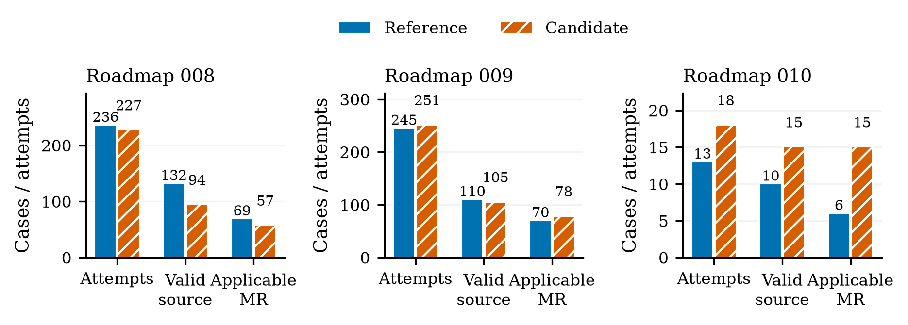
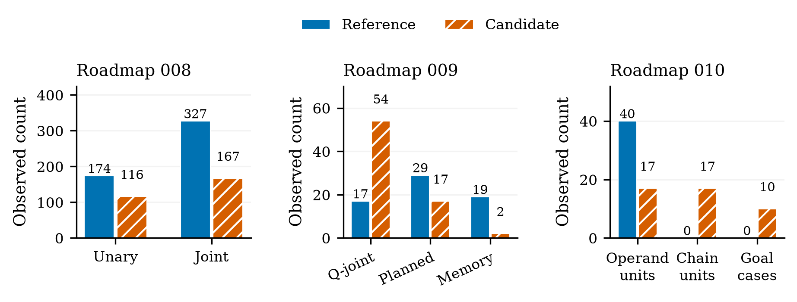
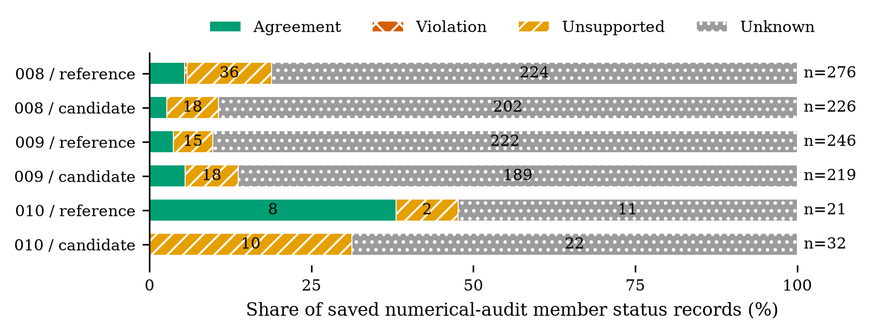

# How Mirage Tests One API: Stateful Exploration, Runtime Evidence, and Conditional Oracles

English technical report, November 15, 2026.

## Abstract

Mirage tests a deep-learning API by placing its actual execution inside generated training programs, exploring tensor representations and training-state transitions, and checking conditional metamorphic relations at aligned semantic checkpoints. The main challenge is establishing a chain from a proposed state to a valid execution and an applicable correctness judgment. This report explains the complete single-API testing procedure, including source/follow-up construction, target-backward evidence, repair, coverage feedback, and a recorded optimizer-update example. It compares the methods and metrics of roadmaps 008–010 using existing frozen protocols and saved results, with no new framework experiments. The evidence shows three distinct outcomes: relational exploration in 008 reduced valid yield, 009 improved some observed joint coverage while planned exploration regressed, and 010 attained ten of ten planned gradient-layout/update goals while losing numerical-audit agreement and ordinary coverage. These single-seed studies establish bounded capabilities and tradeoffs; they do not establish general bug-finding superiority or exhaustive training-state coverage.

## Purpose and Main Takeaway

Given one API, Mirage searches for *executed combinations of tensor representation and training state*. A test is more than a generated API call: it includes an execution configuration, evidence that the intended target and required backward path ran, a checkpoint-specific state obligation, and an oracle whose assumptions have been established. A successful process exit alone provides none of these conclusions.

The project architecture separates a state-transition sampler and MR selector, a training-program generator, and an inspector/correctness oracle. The implemented stateful path realizes these responsibilities through a corpus-guided controller, generated `build`/`run` programs, runtime probes and hooks, and conditional pair evaluation. The generator creates programs and proposes transitions; the framework establishes evidence and decides what can be compared.

This report makes three contributions to understanding the implementation:

-  An operational account of how one API moves through generation, state planning, execution, oracle assessment, and exploration feedback.

-  A precise distinction between operand joint coverage, qualified backward-linked joint coverage, and the optimizer update chain introduced in roadmap 010.

-  A source-linked comparison of roadmaps 008–010 that retains negative results, missing measurements, oracle limitations, and incompatible experimental populations.

**Scope and historical boundary.**  The methods and results here concern the frozen 008–010 engines and the formal campaigns referenced by their roadmaps [rm008], [rm009], [rm010]. The current working tree also contains roadmap 011 changes. Its framework-owned input-representation traversal and revised local-oracle admission are outside this comparison. Likewise, roadmap 009's postformal oracle correction and roadmap 010's later single-arm `slogdet` follow-up are kept separate from the frozen formal comparisons. This is a software testing report; it makes no security-evaluation claim.

## What Constitutes a Stateful Test?

### Program, State, and Execution Case

Let $u$ be the target API and $P_0$ a legal default program. Conceptually, the concrete training state is

$$
\sigma=(\theta,g,o,s,a,r,d,\mu,\xi),
$$
 where $\theta$ denotes parameters, $g$ gradients, $o$ optimizer state, $s$ scheduler state, $a$ AMP state, $r$ RNG state, $d$ data-loading state, $\mu$ tensor metadata, and $\xi$ execution context. This is the *architectural state model*, not a claim that every dimension is fully instrumented in 008–010. In particular, full scheduler, AMP, data-cursor, distributed, and warm optimizer-state exploration remains outside the validated slice.

An abstraction $\alpha(\sigma)$ maps concrete state to observable categories. A target is a predicate $\phi$ at a specified semantic checkpoint $q$. A transition plan $\tau=(a_1,\ldots,a_k)$ proposes actions that should reach

$$
\phi\bigl(\alpha(\sigma_k)|_q\bigr)=\mathrm{True}.
$$
 For example, a tensor predicate can request a nonzero storage offset for the actual operand at call zero. An optimizer predicate can request a noncontiguous gradient for parameter `x` immediately before a native step and a completed update for the same parameter immediately afterward. Predicate fields include call, operand path, checkpoint, and, where needed, axis, peer operand, and parameter key. Equal shapes alone do not identify the same operand.

An execution case is $e=(P,c)$, where $c$ includes device, initialization/seed settings, backward obligations, predicates, and supported harness-owned actions. The source $e_a$ and follow-up $e_b$ form an MR pair. A stateful search need not compare every case to one permanent $P_0$: a valid corpus parent can become the source, and 010 can reuse identical program text under a different gradient-representation configuration. Each child re-executes and must establish its own obligations.

### Conditional Correctness

For MR $M$, output comparison is enabled only if

$$
\begin{split}
 &\operatorname{Valid}(e_a)\land\operatorname{Valid}(e_b)\land
 \operatorname{Aligned}(q_a,q_b)\\
 &\hspace{1em}\land\operatorname{Pre}_M(e_a,e_b)\land\operatorname{In}_M(e_a,e_b).
\end{split}
$$
 Then the oracle evaluates $\operatorname{Out}_M(\operatorname{Obs}_M(e_a),\operatorname{Obs}_M(e_b))$. Preconditions concern such facts as reviewed source effects, operator/domain eligibility, and proven target paths. The input relation constrains initial values, program semantics, environment, and permitted changes. The output relation specifies only the observables justified by that MR. Merely using the same seed does not establish the input relation.

Four principal verdicts follow. *Invalid* means a required execution/path/state obligation failed. *Inapplicable* means the MR assumptions or checkpoint alignment were not established. *Pass* means an applicable output relation held. *Suspected failure* means an applicable relation was violated. A comparison can also remain unassessed when evidence or numerical conditions are unresolved. An inapplicable but source-valid case can contribute verified coverage without receiving a correctness pass. A source can be valid even when its follow-up is unusable; source coverage and pair applicability therefore have different denominators.

## The Single-API Testing Procedure

### Resolve the Target and Establish a Legal Parent

The controller obtains the installed API signature/documentation and target device, then asks the LLM for a small legal program. The stateful contract uses `build(device, seed)` to register named inputs, trainable parameters, and an optional optimizer, followed by `run(ctx, probe)` to express execution order. Target observation uses `probe.call` for ordinary calls and the relevant supported context/factory adapters for other target kinds. This differs from the older canonical training-loop contract, which exposes `forward(ctx)` and `loss(output)`. The report's walkthrough uses the stateful contract actually exercised by the formal campaigns.

Static checks validate syntax, function signatures, registration contracts, and permitted program structure. They do not establish target execution. The worker then executes a fresh source, captures initialization and runtime evidence, and checks that the target and required path ran. In backward-required cases, a loss calling `backward()` somewhere is insufficient: evidence must link the relevant target computation to completed backward. Composite or unobserved edges can remain unresolved despite real execution.

The path policy matters. The 008 and 009 panels use mixed policies and contain valid forward-only/context cases; 010 deliberately requires backward for its differentiable six-API panel. A forward-only case is not retrospectively credited with target-backward coverage.

### Choose a Search Opportunity and a Target State

After parent admission, the controller allocates opportunities among fresh generation, local mutation, and state plans. The feedback sampler uses smoothed estimates of validity, novelty and measured cost, with a uniform exploration component. In the frozen 010 sampler, a candidate's heuristic score is proportional to

$$
\widehat p_{\mathrm{valid}}\,
 \widehat g_{\mathrm{novelty}}/\widehat t,
$$
 and selection mixes normalized scores with uniform probability. These quantities are search heuristics, not unbiased statistical estimators. Family-level history can transfer to new parents while exact goals retain local history.

The bounded goal catalog is built from actual parent observations. Roadmap 008 adds same-call tensor relations and selected-axis predicates, retaining at most three conjunctive goals per plan. Roadmap 009 separates training-state, unary tensor-state, and tensor-relation proposal opportunities; its structured response distinguishes planned from unresolved goals and reports examined IDs. Roadmap 010 adds a library of known configuration transitions for already verified optimizer parents. Being offered, examined, proposed, selected, dispatched, and attained are separate events.

### Generate or Configure the Child

A selected plan identifies actions, target predicates and checkpoints, and injection regions. In the LLM route, the generator edits the parent program while preserving the MR-required semantic inputs and initialization. Operand-binding hints relate selectors to bounded AST expressions and last assignments. Unsupported dynamic binding remains unresolved. The generated edit still needs runtime validation; an expression hint is not an operand witness.

In 010's configuration-only route, the library can reuse a verified source and request an exact-value-preserving gradient action at the optimizer boundary. This avoids regenerating identical computation. The library does not claim the new state has already been reached. Source obligations remain attached to the source; follow-up success cannot satisfy them on its behalf.

Budget admission precedes dispatch. For a known configuration branch, the candidate can use the same parent's measured completed-worker time, retaining reserve $\max(10,1.5t_{\mathrm{parent}}+5)$ seconds. Missing/invalid timing falls back to the ordinary reserve. Fresh quotas and the general execution deadline remain relevant. A planning opportunity can fail to run because of budget admission before any LLM planning request occurs.

### Execute and Verify Reachability

The worker records actual API operands, outputs, metadata, events and checkpoints. Call-entry metadata includes bounded shape/stride, storage grouping/offset and representation properties. Hooks distinguish output gradients, actual target backward Nodes and attributable operand-gradient events. The inspector joins witnesses within the same call and checkpoint; it never assembles a purported joint state from unrelated calls or times.

Each predicate is checked against the relevant observation. Missing metadata yields unknown evidence rather than inferred independence or reachability. Shared storage establishes an allocation relationship, not overlap of occupied tensor coordinates. Operand metadata at forward entry plus a backward event does not prove that the same representation was saved or consumed during backward; ordinary v2 coverage explicitly leaves that claim unsupported.

When a generated program or transition is rejected, feedback identifies the blocking stage and expected/observed obligations. Roadmap 009 avoids worker dispatch for identical or AST-equivalent rejected repairs, and stops state repairs that fail to improve selected obligations after the permitted repair step. Such stopping is a budget tradeoff, not a proof that a state is unreachable. Unresolved runtime exceptions remain distinct from inspector-confirmed contract violations.

### Construct and Assess the Follow-up

For an eligible source, the worker selects a supported conditional relation and constructs its follow-up. For representation testing, this can materialize or transform actual operands under the backend's capability/effect constraints. For 010's optimizer relation, it changes the selected gradient representation at the native pre-update boundary. Target/backward/update obligations survive the transformation; only MR-permitted representation-specific follow-up predicates are removed or adjusted.

The ordinary representation pair observes target outputs and relevant final parameter/input gradients. Writable operations use a narrower materialized-value effect relation when its write-role obligations are established. The optimizer pair observes post-update parameters and optimizer slots. The implementation does not universally compare every loss, parameter, optimizer, scheduler and AMP value for every relation.

The frozen backend's `dtype_scaled_v1` screen checks matching structure, shape and dtype, finite tensors, and a normalized maximum difference. With $s=\max(\|A\|_\infty,\|B\|_\infty)$, its tensor criterion is

$$
\left\|A/s-B/s\right\|_\infty
 \leq \min(0.01,64\epsilon_{\mathrm{dtype}}),
$$
 with zero error when $s=0$. Discrete values use exact comparison; nonfinite or unsupported conditions can remain uncertain. Exact comparison is also retained for the optimizer outputs as a diagnostic. This policy is a bounded numerical screen whose applicability requires prior domain checks, not a universal floating-point equivalence theorem.

Local numerical-gradient audits are separate from MR evaluation. They require their own eligible source effects, target reconstruction/bindings, numerical-domain and stability evidence, and available budget. Statuses include agreement, violation, unsupported and unknown. The latter includes members not selected by the bounded scheduler. An optimizer MR pass does not certify the upstream derivative.

### Persist Evidence and Feed Back

Requests, responses, source/configuration, inspection, verdicts, traces and replay material are saved. Valid cases can enter a versioned corpus when they add defined evidence or coverage; unverified plans and invalid records do not manufacture coverage. Normalized signatures avoid rewarding raw call indices, arbitrary exact strides or transient object identifiers as novelty. Ordinary `state-semantic-2` and optimizer `optimizer-chain-1` units remain distinct even where both influence admission and search feedback.

A suspected failure triggers reproduction/replay and further review. Confirmation requires minimizing a reproducer, revalidating assumptions and numerical conditions, and independent corroboration. Reusing the original finite-difference evidence in a differently named evaluator is not an independent oracle. A recorded `confirmed_*` field alone is insufficient to establish a framework defect.


**Single-API execution checklist and resulting evidence. Failure to establish an item does not imply a framework defect.**

| Stage | Evidence required or retained |
| --- | --- |
| Legal source | Valid contract, concrete initialization, observed target call and required path. |
| State target | Typed predicate, actual selector, legal action proposal, semantic checkpoint. |
| Reachability | Runtime observation satisfying every source obligation; unknown remains unknown. |
| Pair eligibility | Both executions, MR preconditions/input relation, permitted differences and aligned checkpoints. |
| Correctness | Required observables, numerical policy, MR verdict and separate audit statuses. |
| Feedback | Versioned verified units, applicable API–MR pairs, failures, unknown causes and measured cost. |


## Worked Example: One Recorded `torch.add` Search

The candidate arm of roadmap 010 provides a concrete, already executed example [addcase]. Listing 1 condenses its source while preserving the tested computation and SGD options. The exact original program and its SHA256 are included in the report package; the listing is explanatory, not a newly executed experiment.

```python
def build(device, seed):
    x = torch.tensor([1., -2., 3.],
        dtype=torch.float64, device=device,
        requires_grad=True)
    y = torch.tensor([0., .5, -1.],
        dtype=torch.float64, device=device)
    opt = torch.optim.SGD([x], lr=.1,
        momentum=0., weight_decay=0.,
        dampening=0., nesterov=False,
        maximize=False, foreach=False,
        fused=False, differentiable=False)
    return {'inputs': {'y': y},
        'parameters': {'x': x},
        'optimizer': opt}

def run(ctx, probe):
    x = ctx['parameters']['x']
    y = ctx['inputs']['y']
    out = probe.call(torch.add, x, y, alpha=2.)
    out.sum().backward()
    ctx['optimizer'].step()
    return {'out': out, 'x_grad': x.grad, 'x': x}
```


### Fresh Source and Attributable Update

The first attempt is fresh, with no requested predicates. It is CPU float64, backward-required, and registers `x` as the same leaf consumed by SGD. The runtime chain links operand `args[0]` of call zero to the target Node's gradient contribution, completed backward, a parameter post-accumulation event, and the consumed gradient at the native step. A separate optimizer source-effect certificate and native-domain checks establish eligibility beyond merely observing a `step()` event.

By direct calculation, $\mathrm{out}=x+2y=[1,-1,1]$, $\ell=\sum\mathrm{out}=1$, and $\partial\ell/\partial x=[1,1,1]$. For this zero-momentum SGD, the expected updated parameter is $[0.9,-2.1,2.9]$. These are analytical values derived here from the saved program; this report does not reload tensor artifacts or rerun the program to present them as new measurements. The saved JSON does establish exact source/follow-up post-update equality and a maximum parameter change of approximately $0.1$.

### Two Explicit Stateful Children

The verified fresh chain permits two library configurations. Attempt one requires `gradient_representation.contiguous=False` for `x`, call zero, operand `args[0]`, at `optimizer:0/step:0/pre_update`. Its companion requires `optimizer.completed=True` for the same parameter/path at the corresponding `post_update` boundary. The source configuration requests the `strided` action. The next attempt requests `offset_nonzero=True` with the same completed-update companion and an `offset` action.

Both children reuse the source text and re-execute from the MR-required initial state. The harness transforms the gradient only *after backward and before SGD consumes it*, verifies exact logical-value preservation and actual metadata, then observes update completion. For these noncanonical source layouts, the follow-up uses a canonical gradient action. The source and follow-up compare matching pre-step parameters, options, slots and every logical gradient, then matching post-step parameter/slot values.

All three source cases are valid; all three optimizer pairs pass, including exact output comparison. Both planned children reach their own conjunctions. There is one LLM program-generation call, two recorded configuration reuses, and zero LLM planning calls. Three source chain units, approximately 96.28 search seconds and 3,543 saved search tokens are recorded. The numerical-audit member records are two unsupported and four unscheduled unknown; there is no numerical agreement. *These are three related test cases and three pair judgments, not three independent programs or defects.*

### What This Example Does and Does Not Test

The example tests whether native SGD consumes equal logical gradients consistently across their permitted memory representations. It does not show backward writing into a noncontiguous accumulation buffer. It also does not explore an input layout change at `torch.add`: its transformed object is `parameter.grad`. Finally, all generated momentum values are zero, so matching empty slot dictionaries does not demonstrate autonomous nonempty momentum-slot coverage. Positive-momentum native controls validate a supported comparison capability separately from search attainment.

## How the Methods Evolved

### Roadmap 008: Bounded Joint Tensor-State Exploration

Roadmap 008 extends unary representation predicates with selected-axis extent ordering, zero/singleton stride properties, shared storage and their conjunctions [rm008]. Candidate witnesses must belong to the same actual call. Automatic observation is bounded to four operands in typed-path order and first/last axes, with omitted or unknown measurements recorded. Explicit predicates can select additional axes without implying the automatic coverage observer explores them all.

The planner vocabulary is bounded to 29 goals and at most three conjunctive predicates per plan. The implementation connects planning, generation, runtime evidence, joint signatures, corpus admission and reporting. It introduces `state-semantic-2` and rejects mixed/legacy active-corpus versions instead of silently migrating their coverage. The original baseline and new engine are therefore scored with one frozen v2 observer; native v1 versus v2 totals cannot measure improvement.

The final candidate requests 41 tensor-relation goals and attains nine; only two also support an applicable MR. The broader axis-or-relation population is 73 requested, 15 attained and three MR-applicable. The 58 unsuccessful broader attempts include 32 state-attainment failures, 25 unresolved runtime failures and one static-contract failure. These include repair retries, not independent samples. More expressible goals did not produce greater valid search yield.

### Roadmap 009: Evidence-Guided General State Exploration

Roadmap 009 addresses losses exposed by 008: imbalanced proposal supply, operand-selector/source mismatches, nonactionable plans, ineffective repairs, source-effect certificates and excessively fragmented feedback [rm009]. It introduces family-level planning opportunities, structured planned/unresolved responses with examined IDs, bounded AST binding hints, targeted unmet-predicate diagnostics, early duplicate-repair rejection and family-shared cost/validity priors. Prompt coverage summaries reserve bounded representatives for both unary and joint evidence.

The formal reference receives the same corrected source certificate and public API resolver as the candidate. Thus the final contrast concerns a bundle of exploration/generation/controller changes, not the certificate correction alone. The postformal local numerical certificate correction is *not* part of these frozen formal results.

The additional *qualified joint* metric requires original source validity, a source program certificate, a required and observed backward path, and an operand-gradient contribution on at least one side of the joint witness. It does not require both sides and does not mean a planned memory–training conjunction was reached. All 54 candidate qualified joint units come from fresh cases. In the formal search, planned-valid cases decrease from 29 to 17, memory-goal-valid cases from 19 to two, and explicit memory–training goal attempts remain zero in both arms. Training-family attainment rises from 7/16 to 15/38, but the report attributes the added attainments to forward-only boundary/context counts; true backward-lifecycle successes remain two in each arm. Aggregate observed coverage must not conceal this missing planned interaction evidence.

### Roadmap 010: Gradient Representation and Real Updates

Roadmap 010 connects a specific gradient representation to attributable target backward and a completed native optimizer update [rm010]. Its initial admitted domain is dense real CPU float64, exact-type native SGD, cold state, one update, finite positive scalar learning rate, momentum in $[0,1)$, zero weight decay/dampening, disabled Nesterov/maximize/foreach/fused/differentiable modes, and no closure, AMP, scheduler, capture, compilation or foreign hooks.

Stable registered parameter identities and group order replace transient slot indices. Runtime evidence must connect the same target operand, target Node contribution, completed backward, parameter post-accumulate event, and consumed gradient, including object/version/value evidence. A zero VJP or zero parameter change does not invalidate an otherwise proven update; nonzero magnitude is diagnostic rather than an applicability prerequisite.

The MR checks reviewed native domain/source effects; the same program, environment, initial state and registry; exact logical pre-step parameters, gradients and slots; matching completed semantic step; and the sole permitted gradient-representation difference. It compares post-update parameters/slots using the existing screening policy and additionally records exact equality. Its `optimizer-chain-1` signatures are reported separately from ordinary tensor joint units. Neither is a substitute for the other.

After development exposed budget admission before planning, the final bundled treatment adds the configuration library and parent-worker reserve described above, plus generic prompts explaining the already supported straight-line source fragment. The final reference retains the 009 generator/planner/controller with common 010 runtime, contracts, inspector and MR overlays. Consequently, zero observed reference chains are measured zeros under the shared observer. Missing reference configuration-reuse instrumentation is instead reported as unmeasured, even where an exporter defaults its field to zero.


**Method and measurement boundaries. Each row describes the phase's own formal comparison; references are reconstructed with the stated common overlays.**

| Phase | Main method change | Evidence/metric focus | Formal comparison boundary |
| --- | --- | --- | --- |
| 008 | Typed axis/peer goals and bounded joint tensor predicates. | Same-call/checkpoint unary and joint signatures; relation/axis attainment; common v2 rescoring. | Prior baseline versus joint engine; 10 APIs, 180 s/API, mixed path, seed 0. |
| 009 | Family proposals, actionable structured plans, AST binding hints, repair stopping and shared feedback. | Qualified joint; planned, memory and training-goal funnels; certificate/oracle losses. | Phase-008 reference with common certificate/resolver versus candidate; 16 APIs, 120 s/API, mixed path, seed 0. |
| 010 | Attributable gradient/update chain, equal-value layout actions, conditional optimizer MR and configuration library. | Separate optimizer-chain-1 cases/units; layout+update conjunctions; source/follow-up and oracle eligibility. | Phase-009 exploration with common 010 runtime/MR versus candidate; 6 APIs, 120 s/API, backward required, seed 0. |


## Metric Definitions and Comparability

### Cases, Applicability, and Goals

Let $A$ denote persisted attempts, including generation/planning rejections and repair attempts; $V$ original source-valid cases with preserved obligations; and $J$ applicable MR pairs, meaning pass or suspected failure. Then

$$
R_{\mathrm{valid}}=V/A,\qquad R_{\mathrm{MR}}=J/V.
$$
 The second rate is not pass rate over every attempted comparison. Its relationship to validity depends on the explicitly reported source and pair gates. A goal-attainment denominator is all attempts requesting that goal class, including failed generation/execution. For an optimizer conjunction, the numerator also requires the original source-valid linked chain and every requested companion predicate. Zero requested goals yields an undefined rate, not 100% success.

### Coverage Units

*API coverage* counts APIs with validated execution against a declared configured pool; 010 reaches five of six in both arms. *Unary state-semantic units* combine API, operand path, semantic checkpoint, normalized data/representation/state facts, environment and verified path relations. *Joint units* combine same-call operand witnesses and their measured relation. Counts are unique observed signatures, not percentages of all feasible states. The observer's omission counts constrain their interpretation.

*Transition units* identify normalized verified transition signatures within an API; they are not a proof of comprehensive transition-space exploration. *API–MR units* count distinct API/relation pairs with an applicable judgment. *State–MR units* attach applicable relations to verified semantic units. These are observed combinations; candidate sets are bounded and feasibility is provisional. An API's multiple calls or repair retries are not automatically distinct coverage.

*Qualified joint* is 009's additional filtered operand measure. *Optimizer-chain units* are a separate versioned 010 measure for target-linked consumed gradients and updates. Optimizer units are not backfilled into missing historical observations and cannot be added to ordinary units to offset a regression. Source/follow-up and fresh/planned origin are reported separately. A fresh observation can be useful without being a planned target achievement.

### Correctness and Cost

Suspected cases, replayable cases and independently corroborated mechanisms are separate counts. Neither a fixed known-trigger control nor a posthoc recovered candidate is an autonomous discovery. No confirmed-defect rate or false-positive rate can be estimated from incomplete or same-oracle-derived labels.

Coverage or applicable comparisons per second use actual recorded search elapsed time, not the full nominal per-API allowance. Dispatch reserves can end a run early. Audit, worker, rerun and automatic replay times can be nested inside search time and must not be added again. Metadata, service startup, posthoc review and allocation time are separate. Allocated GPU-seconds measure assigned resources, not utilization. Token-normalized rates require complete usage for the declared scope; absent usage does not mean free generation. The 008 candidate and both 009 arms have incomplete native token records. The 010 saved planning/generation token totals are complete for search, excluding metadata and the whole task's other model costs.

## Existing Formal Results

### Protocols and Populations

All three campaigns use exactly one final seed (zero) per arm/API, fresh isolated corpora, balanced or alternating arm ordering, a shared prepared Qwen3.8-27B BF16/MTP3 model service within each study, and frozen runtime/oracle comparisons [result008], [result009], [result010]. Recorded environments include Python 3.14.10, PyTorch 2.15.0+cu132 and NVIDIA H200 allocation hardware. The 008/009 API panels contain CPU and CUDA targets; 010's optimizer panel is CPU eager. Shared model/kernel caches are not fully controlled.

The 008 panel contains ten APIs. The 009 panel adds six preregistered search-held-out APIs, for 16 total; held-out means no development search on those APIs, not that implementation or tests never used them. The 010 panel contains `sin`, `add`, `mm`, `linear`, `tanh` and `bmm`; only `sin`/`add` are development search targets. Table 2 specifies budgets and path policy. Because pools, policies, budgets and capabilities differ, *comparisons are within each phase*. None of the figures is a longitudinal ranking of three interchangeable versions.


**Source cases and ordinary observed coverage in the original formal campaigns. R/C = phase-specific reference/candidate. Unary/joint values use common v2 observation in 008/009 and original v2 search metrics in 010. Qualified joint is unmeasured here outside 009.**

|  | 008 R | 008 C | 009 R | 009 C | 010 R | 010 C |
| --- | --- | --- | --- | --- | --- | --- |
| Attempt records | 236 | 227 | 245 | 251 | 13 | 18 |
| Valid source cases | 132 | 94 | 110 | 105 | 10 | 15 |
| Applicable MR comparisons | 69 | 57 | 70 | 78 | 6 | 15 |
| Valid / attempts (%) | 55.9 | 41.4 | 44.9 | 41.8 | 76.9 | 83.3 |
| MR applicable / valid (%) | 52.3 | 60.6 | 63.6 | 74.3 | 60.0 | 100.0 |
| Source unary units | 174 | 116 | 135 | 121 | 16 | 8 |
| Source joint units | 327 | 167 | 188 | 201 | 24 | 9 |
| Qualified source joint | — | — | 17 | 54 | — | — |
| Autonomous suspected cases | 1 | 0 | 0 | 0 | 0 | 0 |
| Actual search seconds | 1614.79 | 1569.30 | 1572.46 | 1564.98 | 530.09 | 558.68 |




Attempt, valid-source and applicable-MR populations, paired within each phase. Independent panel scales preserve visibility of 010's small panel. Every bar is a recorded count from one seed per API/arm; there are no replicate-based uncertainty bars. Higher applicability conditional on validity can coexist with fewer valid cases. The 010 reference has six applicable ordinary MR pairs and zero applicable optimizer pairs; its candidate's 15 applicable pairs use the optimizer relation.


### 008: Added Capability, Lower Yield

Table 3 and Fig. 1 show valid sources decreasing from 132 to 94, applicable comparisons from 69 to 57, and common source joint units from 327 to 167. Despite the lower number of applicable comparisons, conditional MR applicability rises because valid cases fall faster. Per-search-second valid yield decreases from approximately 0.0817 to 0.0599. Neither the higher conditional rate nor the new goal vocabulary establishes a better search engine.

One baseline `slogdet` suspect is autonomously generated and replayed; the candidate arm has none. Later exact analytical and minimal controls corroborate a known local negative-view backward mechanism. This belongs to the baseline's evidence and does not support an improvement from 008's relational planner. The older evaluator's mechanism attribution reused stored numerical violations; its raw confirmation field is not itself a second oracle. Separate analytical evidence is necessary [rm008].

### 009: Observed Joint Growth, Planned Exploration Regression

Valid sources decrease 110 to 105, applicable MR comparisons increase 70 to 78, common joint units increase 188 to 201, and qualified joint increases 17 to 54. Actual search time is similar, approximately 1572.46 versus 1564.98 seconds. Applicable comparisons per second rise from approximately 0.0445 to 0.0498. These observations support a bounded change in throughput and witness composition, not statistical superiority.

The planned-valid regression (29 to 17), memory-target regression (19 to two) and zero explicit memory–training goal attempts prevent attributing the total joint growth to successful planned interactions. All candidate qualified joint units arise from fresh cases. Formal autonomous suspects remain zero in both arms. Postformal inspection finds a candidate `slogdet` trigger with differing VJPs, but the original source-effect guard excludes both MR assessment and local numerical auditing. A subsequent local certificate correction flags the saved replay while preserving MR inapplicability. That correction and corroboration do not rewrite the formal zero-suspect outcome [rm009].

### 010: A Verified Update Slice with Coverage Tradeoffs

The candidate reaches 15 source-valid linked chains and 17 chain units; the reference has zero chains under the same observer. All ten requested gradient-layout/update child conjunctions are attained. Fifteen optimizer MR pairs pass, and five of six APIs are valid in each arm. The reference has six applicable ordinary representation pairs and zero optimizer pairs; total MR applicability and optimizer MR applicability are separate metrics. Each successful API contributes one fresh source and two configuration children; no LLM optimizer-planning request is sent. Formal source/follow-up records have no nonempty post-update slots, so momentum-slot exploration is unproven.

Ordinary v2 semantic units decrease from 40 to 17, split as unary 16 to eight and joint 24 to nine; transition units decrease from ten to five. The 17 new chain units are not equivalent replacements for the 23 lost ordinary units. Both arms fail to validate `linear`: actual target/backward execution can still lack the direct-edge provenance required by the current domain. The frozen report retains this gap rather than replacing the target or weakening the observer.

Saved search planning/generation tokens are 105,320 versus 29,868; actual search time is 530.09 versus 558.68 seconds. Reusing source configurations reduces these recorded generation tokens but does not establish end-to-end speedup, because execution costs and explored programs differ. Reference reuse instrumentation is unmeasured. All-oracle autonomous suspects remain zero.




Selected observed metrics illustrate different phase-specific tradeoffs. Panel 008 shows common v2 source units; panel 009 shows qualified joint units (Q-joint), planned-valid sources (Planned), and valid attained memory goals (Memory); panel 010 separates ordinary semantic units, optimizer-chain units and attained conjunction cases. Units and cases have different definitions and are never summed across categories. One seed per arm/API, no statistical uncertainty estimate.


**Distinct goal/chain endpoints. Dashes indicate unmeasured or outside the reported scope, not zero. Attained/requested ratios include repair attempts in their specified goal populations.**

| Phase-specific metric | Ref. | Cand. |
| --- | --- | --- |
| 008 relation attained/requested | 0/0 | 9/41 |
| 008 axis or relation attained/requested | 0/0 | 15/73 |
| 008 attained axis/relation + MR | 0 | 3 |
| 009 planned-valid source | 29 | 17 |
| 009 memory goal attained/requested | 19/64 | 2/31 |
| 009 training goal attained/requested | 7/16 | 15/38 |
| 009 memory–training goal attempts | 0 | 0 |
| 010 source linked chain cases | 0 | 15 |
| 010 source chain units | 0 | 17 |
| 010 layout+update attained/requested | 0/0 | 10/10 |
| 010 configuration reuse | — | 10 |


### Oracle Eligibility Must Accompany MR Passes

Figure 3 presents saved numerical-audit *member status records*, including unscheduled members. The 008 reference has 15 agreement, one violation, 36 unsupported and 224 unknown; its candidate has six agreement, zero violations, 18 unsupported and 202 unknown. The 009 reference has nine agreement, 15 unsupported and 222 unknown; the candidate has 12 agreement, 18 unsupported and 189 unknown, with zero violations in both.

The 010 reference has eight agreement, two unsupported and 11 unknown; the candidate has zero agreement, ten unsupported and 22 unknown. Of the candidate unknowns, 21 are not selected by the bounded schedule and one lacks verified original execution/path. The ten unsupported records exceed the numerical source-effect certificate's domain. These counts are neither finite-difference call counts nor independent programs. Optimizer MR pass checks representation consumption, and equal wrong gradients in both members can still produce matching updates. The candidate's zero numerical agreements must therefore remain visible alongside its 15 MR passes.




Composition of saved numerical-audit member status records. Segment labels give counts where space permits, and $n$ is the total record denominator. The single 008 reference violation occupies less than one percent. Unknown includes unselected members, so the plot describes recorded assessment status rather than the probability an executed numerical check succeeds. MR verdicts are a separate measurement.


## Research Position and Limitations

Automatic-differentiation differential testing and numerical-instability filtering precede Mirage: NablaFuzz treats APIs as tensor/vector functions and compares outputs/derivatives across execution scenarios [nablafuzz]. Operator-constraint exploration also has precedents: GPU-Fuzz models operator parameter constraints and uses constraint solving for framework tests [gpufuzz]. These establish relevant methodological context; this report makes no firstness claim for layout variation, gradient testing or generic API fuzzing. Roadmap 010's literature review additionally records native PyTorch precedents for comparing parameter updates across gradient layouts [rm010]. The research hypothesis is the integration of state predicates, attributable runtime evidence, conditional comparisons and coverage-guided exploration.

The evidence has six practical limits. First, the single seed and short, different panels preclude confidence intervals, statistical superiority, and individual-component causal attribution. Repairs, shared source children and paired members are dependent. Second, bounded observers omit operands/axes and have no exhaustive feasible-state denominator. Third, broad architectural dimensions remain partly unimplemented: warm/multiple optimizer steps, other optimizers, AMP/scheduler/distributed interaction and backward-write buffer layouts require new validated slices.

Fourth, source-effect and direct-edge proofs are conservative; missing certificates or composite edges reduce assessment even for legal programs. Fifth, stronger optimizer coverage can reduce ordinary program diversity and numerical-audit eligibility. A budget policy must measure both reached states and assessable states. Sixth, known-trigger controls, posthoc diagnosis, replay, minimization and independent corroboration have different evidential roles. The existing formal studies do not establish zero false positives, zero false negatives, cross-framework generalization or absence of bugs.

## Conclusion

For one API, Mirage builds a bounded search over generated programs and execution configurations, verifies the actual target/path/state, and applies only those conditional oracles whose evidence is established. Roadmaps 008–010 sharpen different parts of that process: relational tensor witnesses, evidence-guided exploration, and a native consumed-gradient/update chain. Their results support the optimizer slice's operational feasibility while exposing valid-yield, planned-exploration and oracle-eligibility bottlenecks. The appropriate next question is how many diverse states become both runtime-verified and meaningfully assessed within a fixed budget.

## Appendix

## Evidence Package and Reproduction Boundary

All report files reside in `technical_report/`. The package contains the original IEEEtran distribution, LaTeX and English Markdown, original fetched scholarly BibTeX and verification endpoints, copied comparison JSONs, source-linked metrics CSV/JSON, exact recorded add source/plans, frozen protocol metadata and SHA256 fingerprints. A deterministic extraction script parses saved JSON without importing Torch, loading raw tensor files or rerunning generated programs. Its cross-checks reproduce the core counts and planned-valid totals used here. The report does not turn static reinspection into new runtime evidence.

Three quantitative figures are generated with matplotlib using the academic-plotting data workflow, an Okabe–Ito color pair plus hatching, PDF vector output and 300-DPI PNG copies. No generative architecture diagram is needed: the procedure is expressed in text, formal conditions and a checklist. Grayscale copies and page renders support visual review. No error bars are invented for the single-seed observations.

The complete unmodified IEEEtran conference skeleton is built before the report. Figure generation, TeX compilation and PDF rendering run as Slurm steps, with all scripts, caches and logs under the report directory. Exact commands, actual checks and resource records appear in the package README and validation log. Formatting uses the IEEE conference class without modifying its geometry or class file. A successful local build is not an IEEE PDF eXpress validation or a claim that this document meets an unspecified venue's submission requirements.

## References and local evidence

- [rm008] [Roadmap 008](../docs/roadmap-008-joint-state-exploration.md).
- [rm009] [Roadmap 009](../docs/roadmap-009-general-state-research.md).
- [rm010] [Roadmap 010](../docs/roadmap-010-optimizer-gradient-chain.md).
- [result008] [Frozen 008 comparison](data/phase-008-comparison.json).
- [result009] [Frozen 009 comparison](data/phase-009-comparison.json).
- [result010] [Frozen 010 comparison](data/phase-010-comparison.json).
- [addcase] [Saved add evidence](data/example-add-evidence.json) and [exact source](data/example-add-program.py).
- [nablafuzz] C. Yang et al., *Fuzzing Automatic Differentiation in Deep-Learning Libraries*, ICSE 2023. [DOI](https://doi.org/10.1109/ICSE48619.2023.00105).
- [gpufuzz] Z. Li et al., *GPU-Fuzz: Finding Memory Errors in Deep Learning Frameworks*, 2026. [arXiv](https://arxiv.org/abs/2602.10478).

Full fetched metadata appears in [references.bib](references.bib). [Evidence index](data/evidence-index.md) maps repository artifacts and hashes. The LaTeX/PDF is the typeset authority; this Markdown is generated from its content.
